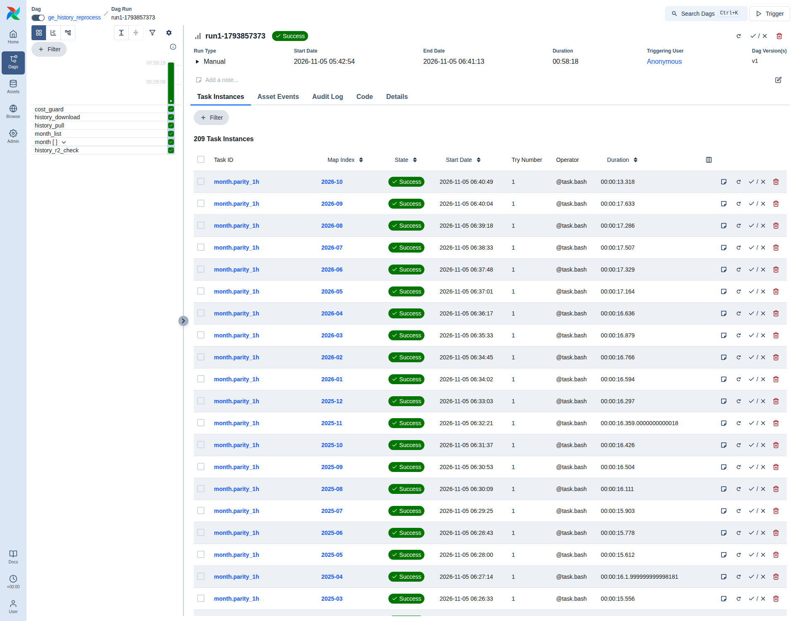
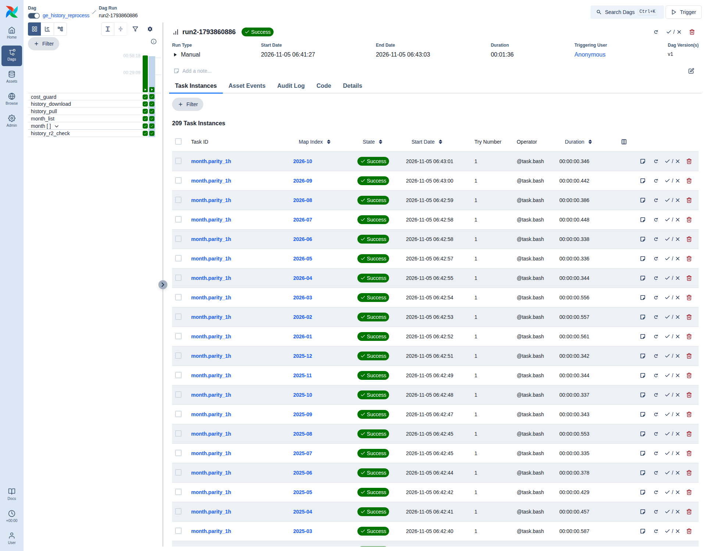

# Airflow 3 and PySpark, brought forward: what ran, and the evidence

**Date:** 5 November 2026; parity corrected and the rebuild rerun on 11 November (UTC). **Decisions:** ADR-0004 and ADR-0011, both amended. **Code:** PR #22 (the PySpark rebuild, parity and benchmark) and PR #23 (the history tasks and the Airflow DAG). Every run below was dispatched from those branches on a GitHub-hosted `ubuntu-24.04` runner (4 vCPUs, 15.6 GB, Python 3.12.3, Temurin Java 17.0.21).

**In one sentence:** an independent PySpark job rebuilt all 68 months of `history/prices_1h` (138,268,178 rows) from the stored inputs and matched both the DuckDB build and R2 on every row, volume and label, with 8 prices one 0.01 GP rounding step apart; and an Airflow 3 DAG ran the same rebuild month by month through the existing task contract (209 tasks in 58 minutes), then found every month recorded complete on a second run and did no work.

## What ran

All runs are hand-started (`history` workflow, `workflow_dispatch`); nothing here is scheduled. Each run read R2 only to restore the stored Wiki responses and to compare against R2's record; none wrote to R2 or asked the Wiki.

| Run | Step | Commit | Result | Duration |
|---|---|---|---|---|
| [41948730929](https://github.com/sKoih-pond/osrs-ge-market-intel/actions/runs/41948730929) | `reprocess`: PySpark rebuild, parity with the DuckDB build, R2's log, manifest and files | `cae1612` | success | 35 min |
| [41982426512](https://github.com/sKoih-pond/osrs-ge-market-intel/actions/runs/41982426512) | `reprocess` with whole-cent parity and flip keys (that rule missed one flip; see Parity) | `60fdfcf` | success | 23 min (dump from cache) |
| [43068526152](https://github.com/sKoih-pond/osrs-ge-market-intel/actions/runs/43068526152) | `reprocess` with the corrected parity rule, after a review (11 November) | `48b0316` | success | 22 min (dump from cache) |
| [41976093751](https://github.com/sKoih-pond/osrs-ge-market-intel/actions/runs/41976093751) | `benchmark`: DuckDB, Polars, PySpark, three runs each | `60fdfcf` | 8 of 9 runs counted; the step fails by design because one Polars run was killed at the 12 GB cap | 34 min |
| [41975553430](https://github.com/sKoih-pond/osrs-ge-market-intel/actions/runs/41975553430) | `airflow`: the DAG end to end, twice | `01dc6c3` | success | 61 min |

Earlier attempts, kept because each changed the code:

| Run | What happened | What changed |
|---|---|---|
| 41951727930, 41958356239 | The benchmark took the whole runner down two minutes into DuckDB (GitHub reports only "The operation was canceled") | Each engine now runs in its own cgroup with a 12 GB cap, so only the engine dies; DuckDB's `partitioned_write_flush_threshold` lowered |
| 41963026174 | Contained, DuckDB and Polars each reached 12.3 GB in under a minute and were killed | The source label is aggregated as a 0/1 code (see Benchmark, finding 2) |
| 41952790026, 41961509370 | The DAG succeeded twice on earlier code; its second runs retried 3 and 11 tasks | Each retry was a process that aborted at exit after finishing its work: a deltalake fault (see Airflow, retries) |

## PySpark reprocessing of `history/prices_1h`

`engines/src/ge_engines/spark_job.py` reads the history job's own inputs on the runner's disk, never R2 (ADR-0015): the 68 pinned dump months (each file cast on its own, because widths differ by month), the 3,391 stored `/5m` fills, and for 2026-01 the 744 stored `/1h` answers. It rolls 5-minute rows up to hourly as the DuckDB build does, re-derives the 2026-01 repair itself, and writes a local Delta table partitioned by month.

| Measure | First run (`cae1612`) | Second run (`60fdfcf`) | Third run (`48b0316`) |
|---|---|---|---|
| Rows, months | 138,268,178 in 68 | 138,268,178 in 68 | 138,268,178 in 68 |
| JVM and session start | 18.9 s | 21.7 s | 21.7 s |
| 67 months rolled up and written (one plan) | 636.2 s | 507.5 s | 417.4 s |
| 2026-01 with its repair | 40.9 s | 33.6 s | 29.7 s |
| Checks after writing | 6.3 s | 6.6 s | 5.3 s |
| Whole job | 702.9 s (11.7 min) | 569.7 s (9.5 min) | 474.4 s (7.9 min) |
| Hours replaced from `/1h` in 2026-01 | 6: 3 January, 15:00 to 20:00 UTC | the same 6 | the same 6 |

The Spark job is the same code in the second and third runs (only the comparison changed), so the difference in time is the runner's.

The six repaired hours are exactly those the DuckDB build replaced on 23 October.

### Parity

`ge-intel history parity --r2-files` compares, month by month: row counts and duplicate keys; keys on one side only; volumes, regime and source exactly; prices exactly, where two prices on the 0.01 GP grid one step apart in whole cents count as a rounding flip (reported, never failed) and any other difference fails. The per-month checksums back the row comparison: a month whose rows all compare equal must also checksum equal, or it fails. R2's side is its Delta log, the `history/months` manifest and a copy of its 68 data files (1.25 GB, one GET each).

From the third run (43068526152, the corrected rule):

| Comparison | Rows each side | Missing, extra, duplicate keys | Volumes, labels | Price errors | Rounding flips |
|---|---|---|---|---|---|
| PySpark against this runner's DuckDB build | 138,268,178 | 0 | 0 | 0 | 8 |
| R2's files against this runner's DuckDB build | 138,268,178 | 0 | 0 | 0 | 0 (exact, equal checksums) |
| R2's files against PySpark | 138,268,178 | 0 | 0 | 0 | 8 |
| R2's Delta log against its manifest and the build | 68 months, 138,268,178 rows | equal | | | |

**Where the flips are.** Every flip is in October 2026, in hours from 17 to 18 October sourced only from stored `/5m` fills (the seam before live data): 17 October 14:00 (item 7058), 16:00 (25975), 20:00 (34027); 18 October 01:00 (32026), 12:00 (13385), 15:00 (20716), 21:00 (1355 and 13000). Those fills carry fractional prices (Jagex data), so the sum of price times volume depends on the order an engine adds the rows, and a value sitting at a rounding boundary moves by one cent. In every other month the two engines agree exactly, and a fresh DuckDB rebuild agrees with R2 to the last bit.

**Why the second run reported 7.** Between the first and second runs the comparison was rewritten to count flips in whole cents, and the new SQL lost any flip on a row whose other price is empty in both builds (an hour with no trades on that side): the empty price made the row's checks null, and a count's filter drops nulls. Item 32026 at 18 October 01:00 had no low-side trades. An independent review found it on 11 November; every check is now true or false, never null, with tests for a flip, an error and a volume beside an empty price, and the third run finds 8, as the first did. The verdict never changed (a flip passes either way); only the count and its explanation did.

## Benchmark: DuckDB, Polars and PySpark

`engines/src/ge_engines/bench.py` times one job in each engine: the 68 dump months and the stored fills, rolled up to hourly rows and written as Parquet partitioned by month (876,754,705 dump rows and 991,304 fill rows in; 138,268,276 output rows, 98 more than `prices_1h` because the one-month repair is left out). Each run is a fresh process with 4 threads, a 6 GB engine memory setting and a 12 GB cgroup cap; engines take turns so none always meets a warm page cache; every run's output is compared with the first DuckDB run's under the parity rules, and only matching runs count.

| Engine | Runs counted | First run | Median of the others | Peak memory | Rounding flips against the reference |
|---|---|---|---|---|---|
| Polars 2.1.0 | 2 of 3 | 95.6 s | 94.0 s | 12.0 GB | 7 to 9 |
| DuckDB 1.5.6 | 3 of 3 | 152.1 s | 165.8 s | 6.1 GB | 0 to 1 |
| PySpark 4.2.0 | 3 of 3 | 291.8 s | 295.8 s | 7.0 GB | 2 |

Times are wall clock for the whole process; PySpark's include starting its JVM and session (18.9 to 21.7 s in the reprocessing runs). Peak memory is the whole process tree's. The flip counts in the last column come from the comparison as it was before the fix described under Parity ("Why the second run reported 7"), so they can undercount; the timings, and whether each run matched, do not depend on it. The benchmark has not been rerun.

Findings:

1. **On one 4-core runner, Polars is about 3 times as fast as PySpark, and DuckDB 1.8 to 1.9 times.** PySpark's place in this project is the independent second implementation behind the parity check and the path to more machines (ADR-0011), not speed at this scale.
2. **String aggregates do not spill.** The first contained run lost DuckDB and Polars at 12.3 GB within a minute: `min(source)` and `max(source)` over 138 million hour-item groups keep copies of a 33-byte label, about 11 GB that neither engine can move to disk. Every engine now aggregates a 0/1 code and maps it back, with identical output. The production build never meets this: it works a month (about 2 million groups) at a time.
3. **Polars does not hold this job to its out-of-core budget.** It peaked at 12 GB against a 6 GB budget, and the cgroup killed one of its three runs at 12.3 GB. It is the fastest engine whenever it finishes.
4. **Rounding has to be written to agree.** Spark's `round(x, 2)` rounds the shortest decimal form half up (1.005 becomes 1.01, where DuckDB gives 1.0), so the Spark job rounds `x * 100` to a whole number as DuckDB does. Polars compiles `x / 100` into `x * 0.01`, which moves the last bit of about one price in seven, so the Polars job uses its own `round(x, 2)`. Tests pin both against DuckDB on 20,000 and 40,000 random prices.
5. **No engine is bit-for-bit repeatable here.** Even DuckDB's second run differed from its first by one price, one cent apart: parallel float sums depend on the order rows arrive.

## Airflow 3: the history DAG on the task contract

Airflow 3.3.2 ran on the runner in its own environment, installed from its constraints file in a step with no secrets in reach, with the runner's Postgres 16, the LocalExecutor (parallelism 4) and the API server on localhost only. `orchestration/ci/run_airflow.sh` triggered `ge_history_reprocess` through the REST API twice; `orchestration/ci/drive.py` exported each run and its task instances and took the screenshots below.

```
cost_guard -> history_download -> history_pull -> month_list
  -> month[2021-03 .. 2026-10]: build_1h_duckdb, reprocess_1h_spark -> parity_1h
  -> history_r2_check
```

Every task but the cost guard (`ge-intel guard`) and `month_list` is `ge-intel run <task> --start --end` over whole UTC months; each records its run in `ops/task_runs` on the runner's disk (207 records, all marked `airflow`). The DuckDB and PySpark builds each have a pool of one slot: one writer per table. Every task but the cost guard retries twice with backoff.

**Run 1** (`run1-1793857373`): success, 58 min 18 s, 209 task instances, no retries.

| Task | Instances | Median | Total |
|---|---|---|---|
| `cost_guard` (one R2 usage query) | 1 | 3.9 s | 3.9 s |
| `history_download` (the dump, 4.8 GB from Kaggle; cache cold) | 1 | 441.2 s | 441.2 s |
| `history_pull` (4,269 stored responses from R2) | 1 | 6.7 s | 6.7 s |
| `month.build_1h_duckdb` | 68 | 6.8 s | 549.8 s |
| `month.reprocess_1h_spark` (one JVM per month) | 68 | 42.6 s | 2,987.2 s |
| `month.parity_1h` | 68 | 13.6 s | 911.4 s |
| `history_r2_check` (68 months, 138,268,178 rows against R2's log and manifest) | 1 | 9.9 s | 9.9 s |

Monthly parity under Airflow: 67 months exact; 2026-10 equivalent with 7 rounding flips, all in the fill-only seam hours. This run (`01dc6c3`) predates the corrected rule, so its count misses the eighth (18 October 01:00, item 32026).

**Run 2** (`run2-1793860886`), the same range again: success, 1 min 36 s, 209 task instances, no retries, and no run record added. Every contract task found its month recorded complete in storage and returned in under a second.





**Retries, and the fault they found.** The second runs of the two earlier end-to-end runs retried 3 and then 11 tasks. The kept logs show each task logging `task_skipped` and then dying with SIGABRT about three seconds later, after its work was done. On a laptop the same fault hangs instead: after deltalake 1.6.6 reads a table through its pyarrow dataset bridge, 5 of 6 fresh processes hang at exit, while opening a table or reading with pyarrow alone never does. No newer deltalake exists, so under Airflow a history task now ends with `os._exit` once its run record is committed and its output flushed (`GE_EXIT_HARD`, set only by the Airflow harness). The final run needed no retries. Since that run, the cost guard and the harness's final records check, which read the run records too, end the same way (commit `4ba3a38`); that change has not yet run under Airflow.

**Credentials.** The R2 keys and the analytics token are written to a mode-600 file and removed from the environment before Postgres or any Airflow process starts; only `cost_guard`, `history_pull` and `history_r2_check` load them, and never through a templated field (Airflow stores those and returns them over its API). The Spark processes get no credentials. The kept artifact was checked for both key values: none present.

## R2 operations and cost

| | Class A | Class B |
|---|---|---|
| Budget for the programme (plan) | 150 | 3,200 |
| Stop-and-review line (plan) | 1,000 | 10,000 |
| Measured: every operation on the bucket from 01:27 to 08:07 UTC, production's hourly runs included | 587 | 5,699 |
| Measured: the same, less the hourly runs' own guard windows | 38 | 687 |

Measured from the hourly cost guard's month-to-date lines, with no extra queries. Some of these runs' reads fell inside an hourly window, so the net figure slightly undercounts them and the first row is the safe bound. These runs wrote nothing to R2: the guard read 2.13 to 2.14 GB stored that day, the growth being the hourly path's own writes. Every hourly guard check that day allowed its run, and every hourly and watchdog run succeeded. Cost: $0 (public-repository runners, no new services, no new accounts).

## Tests in CI

| CI job | What | Count |
|---|---|---|
| `test` | The main suite: parity rules, the history tasks on the contract, a month built alone equals the full build (2026-01 repair included), the workflow rules | 196 |
| `spark` (Java 17) | Engine tests (rounding against DuckDB, response parsing, column widths, the roll-up, three engines on synthetic data) and the PySpark rebuild against the DuckDB build on the fixture month, repair included | 9 + 2 |
| `airflow` (Airflow 3.3.2) | DAG integrity: imports, one mapped group per month, pools, retries, who loads credentials, the 68-month range | 6 |

## Not built yet

- The backtest and sensitivity grid on PySpark (M4), and any model.
- Airflow on the always-on VM (Phase C), and the hourly path under Airflow: it stays on GitHub Actions with ge-clock.
- dbt through Cosmos, Weird Gloop history, and the history-plus-live union models (M2).
- A read-only R2 key for these steps. Today they use the read-write key, and the code, the tests and the credentials file keep it to reads; a key that cannot write would make that hold by construction.

## Reproduce

```bash
gh workflow run history.yml --ref <branch> -f step=reprocess
gh workflow run history.yml --ref <branch> -f step=benchmark
gh workflow run history.yml --ref <branch> -f step=airflow
```

Each keeps an `evidence-<step>-<run id>` artifact for 90 days: the parity report, the benchmark results, or the Airflow runs, task instances, screenshots, run records and logs. Counts, keys and timings only: no price data leaves the runner.
