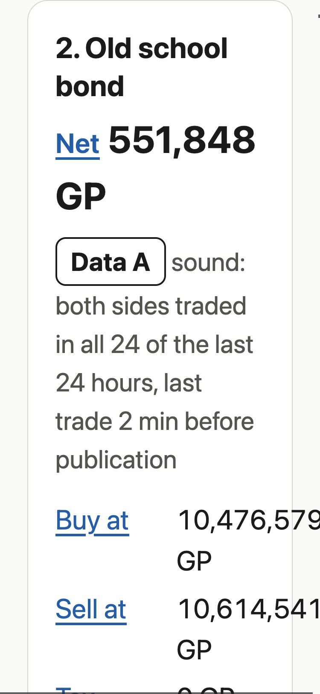
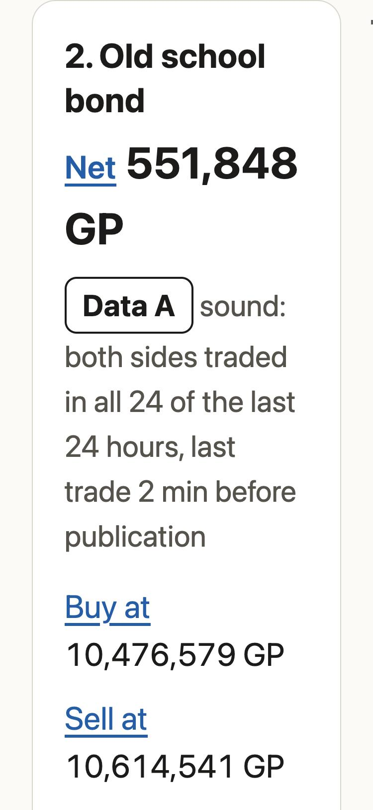
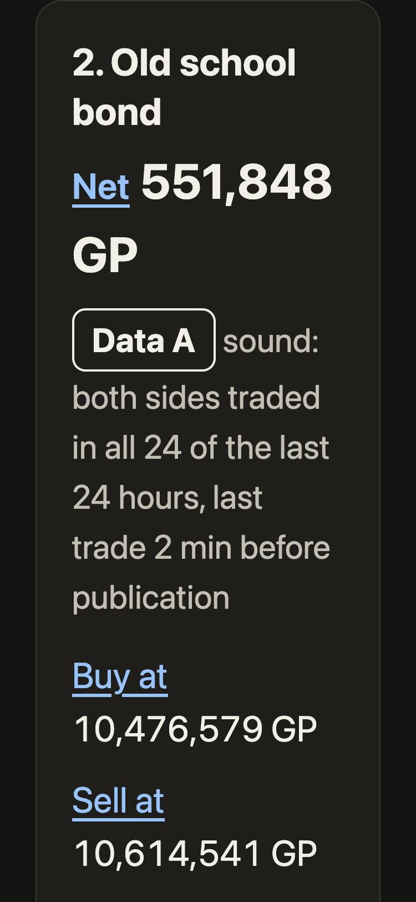
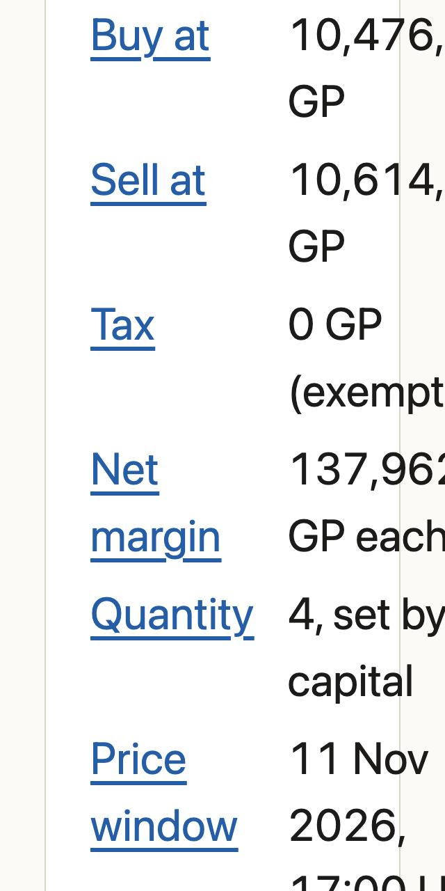
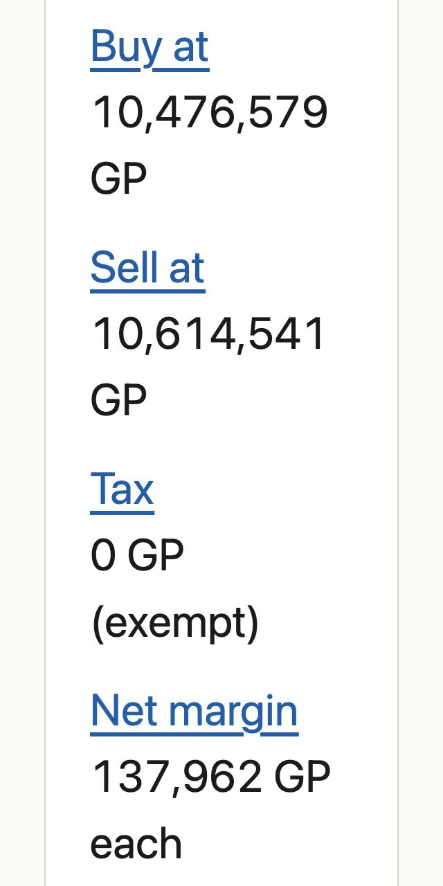
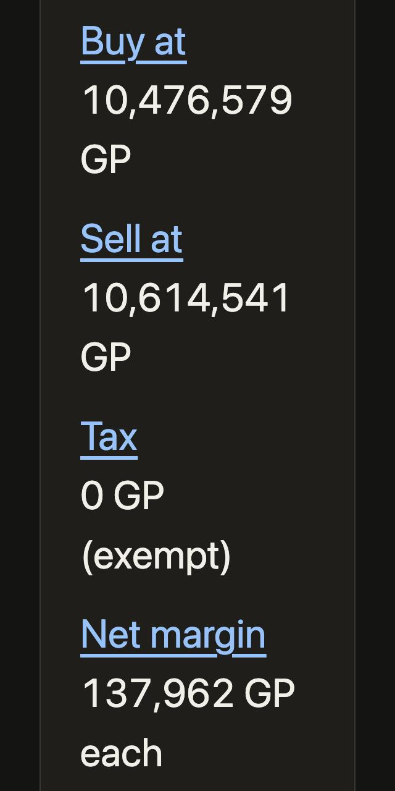
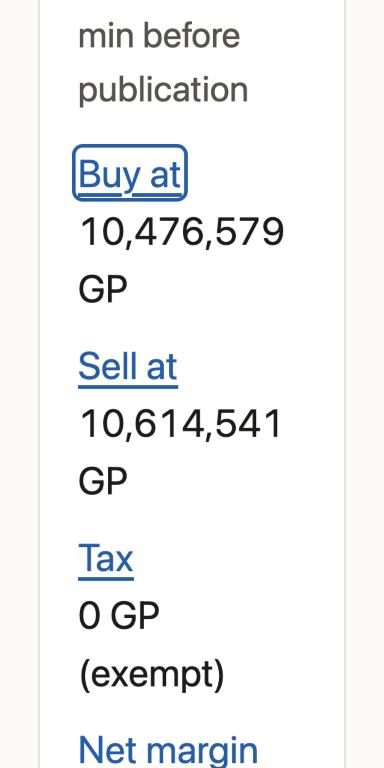

# Idea cards at 200% text, 375 and 320 px

Measured 12 November 2026 (UTC 11 November) for the change to `site/src/ge/style.css` on branch `site/text-scale-cards`. The brief's accessibility floors require the screener to be usable at 200% text and at 320 px (`docs/kickoff/problem_brief.md`, `docs/kickoff/acceptance_tests.md`).

## The fault

Each card's facts sat in a two-column grid, `fit-content(50%) 1fr`. A value such as `10,476,579 GP` cannot wrap inside the number, so at large text the value column grew past the card. The longest values pushed the page wider than the screen and it scrolled sideways.

## The change

CSS only. No markup, script or data change.

- `.idea` is a size container (`container-type: inline-size`), and its text may wrap anywhere as a last resort (`overflow-wrap: anywhere`), so nothing can run past the card.
- Below 14rem inside the card, each label sits above its value. A label beside its value needs about 14rem: the widest label (6rem), the gap, and a price with its unit (7rem). At 100% text a card is about 15.9rem wide inside, both at 320 px and at its narrowest in the multi-column grid, so the 100% layout does not change.
- Below 7.5rem (320 px from about 180% text) the Net figure steps from 1.375rem to 1.125rem. That keeps a seven-digit amount whole instead of breaking it mid-number, and leaves the figure above body size.
- The status page's `.facts` lists have no `.idea` around them, so none of this reaches them (see "Found, not changed").

## How it was measured

- A local copy of `site/src` with the live snapshot for the hour ending 11 November 2026 18:00 UTC (100 ideas). `status.json` was aged two days so the stale banner shows in every run.
- Chromium 156 with mobile emulation at 375x812 and 320x640 (device pixel ratio 2, system font SF Pro), light and dark.
- `text_scale_cards_measure.js` (in this folder) sets the root font size from 100% to 200% in 10% steps. That is what a larger browser text size does to this page, which is sized in `rem`. At each step it records:
  - the document width against the intended width;
  - any text or box past the screen edge;
  - any card content past the card's content edge;
  - any number wrapped across lines.
- The intended width is a constant on purpose. A mobile viewport widens itself to fit overflowing content: at 200% before the change, `innerWidth` was 379 at a 375 px setting. A check against `innerWidth` would pass the broken page.
- The before and after numbers both come from the same script. For the before run, the local copy pointed at `main`'s stylesheet.

## Results

Before, with `main` (cards with content past their edge out of 100; worst case; document width):

| Text | 375 px | 320 px |
|---|---|---|
| 100% to 140% | 0 | 0 |
| 150% | 0 | 9 cards, 13 px |
| 160% | 0 | 29 cards, 36 px |
| 170% | 9 cards, 3 px | 66 cards, 58 px, page 323 px |
| 180% | 28 cards, 26 px | 100 cards, 81 px, page 342 px |
| 190% | 48 cards, 48 px | 100 cards, 103 px, page 360 px |
| 200% | 66 cards, 69 px, page 379 px | 100 cards, 124 px, page 379 px |

After, at every step from 100% to 200% at both widths, in light and in dark: document width 375 or 320 px exactly, 0 cards with content past their edge, nothing past the screen edge, 0 numbers wrapped.

At 375 px the labels stay beside their values up to 120% text and move above them from 130%.

### Unchanged

These layouts are identical before and after the change. The check is a hash of every element's box, taken at the top of the page.
- **Screener:** 100% text at 375, 320 and 1280 px, and 200% text at 1280 px.
- **Status page:** 100% and 200% text at 375 and 320 px.

### Stress data

To test values the measured hour did not have, the local snapshot was edited:
- a Net of 12,345,678 GP and another of 3,456,789 GP;
- prices of 49,999,999 and 51,234,567 GP;
- the name `Superantipoisonplusplusmixturebottle(4)`;
- a Data grade reason containing a 40-character unbroken word.

No card or page content passed an edge at any step at either width.

One residual: at 320 px and 200% only, the eight-digit Net wraps inside the number (`12,345,67` / `8 GP`). In practice this can't happen. A Net of 10M GP needs roughly a 20% net return on the whole 50M GP capital in one trade, and the largest Net in the measured hour is 592,626 GP. Seven-digit Nets stay whole.

### Other checks

- **Keyboard:** at 320 px and 200%, Tab from the Data badge to "Buy at" in the second card shows the 3 px focus ring fully inside the card. Enter jumps to the definition (`#def-buy_price`, at the top of the screen).
- **Stale banner:** shown in every run and within the content edge (right edge 288 px at 320 px).
- **Colour, contrast and motion:** none changed.
- **Local CI:** `ruff check`, `ruff format --check` and `pytest` pass.

## Found, not changed

At 320 px and 200%, some values on the status page reach past the content edge into the side padding, by up to 16 px: `100.0%` by 16 px, `ending` by 10 px and `of` by 8 px. The page does not scroll sideways and nothing is clipped, so it passes the checks above. Letting those values wrap anywhere, as the card text does, breaks them mid-token (`17:2|7`, `100.0|%`, `(6,85|2`), so the status page was left as it was. A possible follow-up is to stack the status facts the same way.

## Screenshots

At 200% text, light unless marked. The same card (rank 2) is shown before and after.

| 375 px before | 375 px after | 375 px after, dark |
|---|---|---|
|  |  |  |

| 320 px before | 320 px after | 320 px after, dark | 320 px keyboard focus |
|---|---|---|---|
|  |  |  |  |
