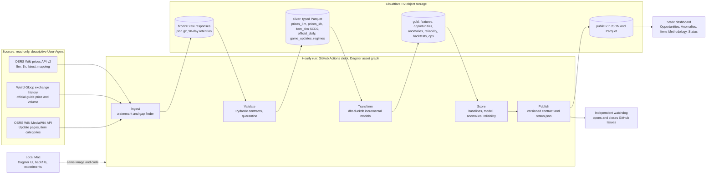
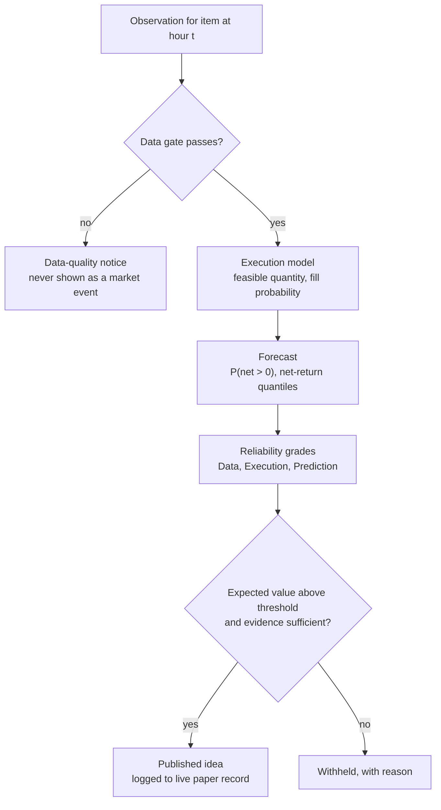

# OSRS Grand Exchange Market Intelligence: discovery report

**Date:** 20 October 2026 (probes run 19 October 2026, 17:55 to 18:30 UTC)
**Status:** Research and recommendations for review. Nothing has been built, provisioned or registered.

> **Decisions taken 20 October 2026:** see `../decisions/2026-10-20_kickoff_decisions.md`. It supersedes this report where they differ, mainly: Airflow 3 adopted at Phase C instead of Dagster; Delta Lake as the table format; PySpark for the backtest grid and reprocessing; three personas (Flipper, Casual, Holder); dashboard served by a Cloudflare Worker at kohstack.tech/ge/; Phase C committed after v1. Sections 6.3, 6.6 and 7 are partly out of date.
**Labels used:** FACT (verified against a primary source or measured), PLAUSIBLE (reasoned or secondary-source), OPEN (needs an experiment or your decision).

---

## 0. Summary

**What changed under the brief while it was being written.** Three facts reshape the project:

1. **The price data changed source on 30 September 2026.** The Wiki's real-time API now states that data before that date came from RuneLite only, and all new data comes from Jagex across all game clients. FACT. I measured the break: total traded volume in a matched Tuesday 12:00 UTC hour roughly doubled (about 39M to about 80M items), per-item 30-day volume rose 1.25x to 1.80x, and median relative spreads widened (coal 1.39% to 2.05%, shark 1.43% to 2.01%). Old school bond's median spread was negative before the switch and positive after. History was not restated. The project therefore starts with about 5.6 years of RuneLite-sampled history plus about 20 days of complete Jagex data, separated by a structural break.
2. **The same day, Jagex shipped "Beyond Max Cash".** GE offers can now exceed 2,147,483,647 coins, and guide prices update every 3 hours with up to 20% movement (previously every 24 hours, 5% cap). Very high-value items now enter the GE dataset as new, very thin markets. FACT.
3. **The API is at v2.** v1 "may be removed in the future"; `/timeseries` now takes a `lookback` instead of a `timestep`. GE Seer still calls v1. FACT.

**What the data supports.** The `/1h` endpoint is an exact roll-up of `/5m` (volumes matched on 3,234 of 3,234 items; high-side VWAP within 0.1% on 2,638 of 2,640). History goes back to 8 March 2021. The full hourly history is about 145M rows, roughly 1.5 GB as Parquet. This is medium data: DuckDB on your 8 GB laptop handles it, and Spark is not justified by volume.

**What the product should be.** A tax-aware, execution-aware opportunity screener and anomaly feed with separate, measurable reliability grades. Machine learning should be an optional layer that ships only if it beats a transparent baseline on post-switch data. After a 2% tax and a typical 1.5% to 2% spread, most 24-hour directional calls will not clear costs, so the honest value lies in screening, execution realism and trust signals.

**Recommended architecture.** A zero-cost "serverless lakehouse": GitHub Actions provides the hourly clock and compute, Dagster defines the asset graph (partitions, backfills, checks), Parquet lives in Cloudflare R2, dbt-duckdb builds incremental models, and a static dashboard reads a versioned data contract. The same code runs locally with the Dagster UI for backfills and experiments, and can move to an always-on VM later without rewriting.

**Decisions I need from you** are in section 9. The gating one is the runtime and storage choice (Option B with Cloudflare R2).

---

## 1. Deliverable 1: domain research and knowledge map

### 1.1 Grand Exchange mechanics that affect the application

| Mechanic | What is confirmed | Source | Implication for us |
|---|---|---|---|
| Matching | A trade happens when a buy offer is at or above a sell offer. The price is that of the offer placed first: a new buy fills at the resting lowest sell and the buyer is refunded the difference; a new sell fills at the resting highest buy. Older offers at the same price are "loosely prioritised". | GE wiki page, citing Jagex's "Secrets of the Grand Exchange" | Recorded prices are resting-offer prices. "High" (instant-buy) and "low" (instant-sell) are the prices aggressive buyers and sellers paid or received, not quotes. |
| Visibility | No order book, no depth, no queue position is public. Volume is not shown in-game; the official GE database shows it. | GE wiki | Fill probability and queue position cannot be observed. They must be modelled and stated as assumptions. |
| Tax | 2% on new offers since 29 May 2025 (was 1% from 9 Dec 2021). Rounded down per item, capped at 5,000,000 coins per item. Below 50 coins the tax rounds to zero. Exempt list: bonds, energy potion, low-level arrows, darts and mind runes, low-level food, teleport tablets, games necklace(8), ring of dueling(8), and common tools. More low-value items were exempted on 29 May 2025. | GE wiki and changelog | Net proceeds per item = `p - min(floor(0.02p), 5,000,000)` unless exempt. Any backtest before 29 May 2025 must apply the 1% rule, and before 9 Dec 2021 no tax. |
| Item sink | Jagex buys back a static, Jagex-specified number of listed items each week, funded only by tax receipts, and deletes them. The list changed on 29 May 2025 (Burning claws added; eleven items removed, including Occult necklace and Kraken tentacle). | GE wiki, Mod Ash on Discord (29 May 2025) | A weekly, policy-driven demand source for about 60 high-value items. Removal from the list is a regime change for those items. |
| Buy limits | Purchases are capped per item "every 4 hours". Some items share a connected limit (for example all doses of Prayer potion). There is no selling limit. | GE wiki | Feasible quantity per trade is `min(limit, capital, share of volume)`. 510 of 4,663 mapped items have no limit value in `/mapping`: unknown, not unlimited. Whether the window starts at first purchase is community knowledge: PLAUSIBLE, verify. |
| Slots | Members have 8 offer slots (since 6 July 2015); free-to-play accounts have 3. | GE wiki changelog | Capital and attention are slot-constrained. Rank by GP per slot-hour or slot-day, not raw margin. |
| Guide price | Set from recent trade history. Since 30 Sep 2026 it updates every 3 hours and can move up to 20% per update (previously 24 hours and 5%). Lower-volume items now update more often. Jagex can intervene. | Update: GE Improvements: Beyond Max Cash | Guide-price features before and after 30 Sep 2026 are not comparable. The guide price is a lagged smoother, not an executable price. |
| Max cash | Offers can exceed 2.147b via coins plus platinum tokens (system cap about 2.149 trillion). Buy limits and the 5M tax cap are unchanged. | Same update | New ultra-high-value markets join the dataset after 30 Sep 2026. Store prices as 64-bit or decimal; the API warns prices can exceed 32-bit. |
| Offer persistence | Offers from players logged out for several days pause until they log back in. | GE wiki | Some resting liquidity is dormant. Thin markets can gap. |
| Eligibility | Ironmen can only buy bonds. New free-to-play accounts are trade-restricted until 20 hours played, 10 quest points and 100 total level. | GE wiki | Target user is a normal members account. |
| Sets and decanting | Armour sets can be assembled or split at GE clerks. Bob Barter decants potions. | GE wiki | No-cost conversions create testable price relationships (set vs parts, 4-dose vs 3-dose per dose) for relative-value signals and anomaly baselines. |

### 1.2 What drives prices (evidence-graded)

| Driver | Mechanism | Evidence grade | Modelling use |
|---|---|---|---|
| PvM supply | Boss drop rates and player activity set the inflow of uniques. New bosses add new supply and can devalue substitutes. | PLAUSIBLE (well known; secondary sources describe crashes after major releases, unverified figures) | Event flags from the update calendar; decay after release. |
| Consumable demand | Combat and skilling consume food, potions, runes, ammunition. Content shifts which supplies are needed. Sailing (released 19 November 2025, per release coverage) is reported to have changed demand for timber and ore. | PLAUSIBLE | Category-level demand indices; cross-item co-movement. |
| Gold sinks and inflation | The GE tax removes most of its receipts from the game; the 2025 increase to 2% raised the sink. Item sink buybacks recycle a small share. | FACT (mechanism), OPEN (net inflation rate) | Price-index drift term; deflate long histories by a GE-wide index before comparing years. |
| Policy floors | High-alchemy value minus a nature rune is a soft price floor for many items (`highalch` is in `/mapping`). Item-sink buybacks support listed items. | FACT (inputs), PLAUSIBLE (floor strength) | Distance-to-alch-floor feature; floor-breach anomaly. |
| Activity and seasonality | Weekends trade more. In my October sample, Saturday and Sunday 12:00 UTC hours carried 79M to 91M items vs 74M to 80M on weekdays. Weekly game updates take worlds offline (30 Sep 12:00 UTC volume fell to 19M vs about 38M on adjacent Tuesdays). | FACT (sample), PLAUSIBLE (generalisation) | Hour-of-week baselines; outage flags; never treat an update-hour dip as a market event. |
| Speculation and thin markets | Rares and discontinued items trade rarely; guide prices update slowly; single trades move recorded prices. | FACT (guide-price behaviour), PLAUSIBLE (manipulation) | Data-quality gate before any anomaly is called a market event. Never label manipulation. |
| Complements and substitutes | Doses, sets, herb to potion chains, gear tiers. | PLAUSIBLE | Relative-value features and residual anomalies. |

**Item categories.** `/mapping` has no category field. I recommend two data-driven axes for modelling (liquidity tier from volume x price, and price tier) plus a small set of curated economic families from Wiki categories via the MediaWiki API (consumables, runes and ammunition, raw materials, equipment, rares). Use one pooled model with segment features and report evaluation per segment. Per-item models (the GEPrediction approach) do not scale to about 3,300 active items and overfit thin series.

### 1.3 Where financial-market thinking does and does not transfer

| Concept | Transfers? | Why |
|---|---|---|
| Bid-ask spread | Partly | High and low are separate trade averages with independent timestamps, not simultaneous quotes. In `/latest`, 571 of 4,540 items (12.6%) showed low above high. Treat "spread" as a noisy estimate of round-trip cost. |
| Depth and liquidity | No (depth), Partly (activity) | Only transacted volume is visible. Liquidity must be inferred from volume, trade frequency and staleness. |
| Continuous trading | Mostly | 24/7, but weekly update downtime and population cycles create structured gaps. |
| Short selling, leverage | No | You can only sell what you hold. Strategies are long-only with slot and buy-limit caps. |
| Transaction costs | Yes, and larger | 2% sell-side tax plus spread. A round trip needs well over 2% gross to profit. |
| Market efficiency | OPEN | Many active flippers and dedicated tools compete for spreads. Do not assume the GE is more predictable than equities; test it. |
| Exogenous shocks | Different | Developer interventions (tax changes, sink lists, content releases, max cash) are announced and dated. They are a calendar, which helps attribution. |
| Data provenance | Different | The measurement process itself changed on 30 Sep 2026. Financial tick data rarely changes source mid-series. |

### 1.4 Knowledge map

**Confirmed (FACT)**
- Matching rule, tax rate, cap, rounding, exemption list, item-sink list and weekly mechanism, 4-hour buy limits, 8 member slots.
- 30 Sep 2026: data source switch (Wiki) and Beyond Max Cash with faster guide prices (Jagex).
- API v2 endpoints and semantics; v1 deprecated; descriptive User-Agent required; common default User-Agents blocked.
- `/1h` equals the sum of twelve `/5m` buckets (measured).
- Earliest data: 8 March 2021 present, 1 March 2021 empty (measured); matches RuneLite's 8 March 2021 announcement.
- Official guide price history from 28 March 2015 and official volume from 25 September 2018 via Weird Gloop (measured).

**Plausible (needs confirmation in M2)**
- Buckets are final when published. Two buckets were unchanged after 22 minutes and 2.5 hours, but both reads were CDN-cached copies. A proper revision audit is needed.
- Post-switch volumes are near-complete GE volumes (Wiki volume was 0.94 to 0.95 of official volume for three items tested).
- Pre-switch RuneLite coverage varied by item and over time: nature rune 0.19 to 0.72 of official volume between Nov 2025 and Sep 2026, with a step up in February 2026; shark 0.46 to 1.01; whip 0.63 to 1.00.
- The widened post-switch spreads reflect a different trader population (all clients, including mobile) rather than a market change.

**Open questions**
- How Jagex classifies a trade as instant-buy or instant-sell in the new feed, and whether that definition differs from RuneLite's.
- Exact buy-limit window semantics.
- Whether any edge survives the 2% tax after realistic fill modelling (the central empirical question, M4).
- Whether pre-switch history helps or harms post-switch models.

### 1.5 Implications

- **Features:** normalise volume within regime (ratio to the item's own trailing median in the same regime), never in raw units across 30 Sep 2026. Keep spread features regime-aware. Include staleness, one-sidedness, buy-limit pressure, distance to alch floor, hour-of-week, category index residuals and event flags.
- **Model choice:** pooled gradient boosting or regularised logistic models over hand-built features; no per-item sequence models.
- **Backtesting:** apply the tax schedule that was in force; simulate fills with explicit rules; report pre-switch and post-switch separately; post-switch is the headline.
- **Reliability:** carry the regime flag and sample size into every score; withhold predictions when evidence is thin.

---

## 2. Data-source assessment

### 2.1 Endpoints (API v2, `prices.runescape.wiki/api/v2/osrs`)

| Endpoint | Content | Use |
|---|---|---|
| `/mapping` | 4,663 items: id, name, examine, members, low and high alch, value, buy limit, icon | Daily snapshot into an SCD type 2 item dimension, so limit and alch changes are tracked from now on. |
| `/latest` | Per item: last high price and time, last low price and time (4,540 items) | Hourly snapshot for staleness and data-quality grading only. |
| `/5m?timestamp=` | Per item per 5-minute bucket: VWAP high, high volume, VWAP low, low volume (about 1,900 items per bucket) | Atomic grain from 30 Sep 2026 onward; drives anomalies and fill simulation. |
| `/1h?timestamp=` | Same fields per hour (about 3,300 items per hour) | Backfill of full history; reconciliation check against `/5m`. |
| `/timeseries?id=&lookback=` | One item; lookback 6h to 1y; timestep "not guaranteed". `6m` and `1y` returned daily points. | Spot checks only. Bulk ingestion must use timestamped bucket endpoints (the Wiki asks for this). |

### 2.2 Measured properties (19 Oct 2026)

| Property | Measurement |
|---|---|
| Staleness in `/latest` | Median 590 s since last trade; p75 70 min; p90 15 h; p99 about 30 days |
| One-sided buckets | In 24 hourly buckets (79,949 item-hours): 17.6% had no instant-buy average, 13.4% no instant-sell average |
| Coverage | Only 2,281 of 4,257 items traded in all 24 hours |
| Publication latency | Buckets appear in the CDN about 10 to 20 s after they close; `Expires` aligns with the next bucket |
| Caching | Cloudflare, `s-maxage=300`; timestamped requests returned `HIT`. Deterministic timestamped requests mostly hit the cache, which keeps our load off the Wiki's origin. |
| `latest`-style 1h lag | The un-timestamped `/1h` served a bucket one hour older than the newest complete bucket (cache effect). Always request explicit timestamps. |
| v1 vs v2 | Same rows; v2 has two-decimal averages; 41 of 3,234 rows differ by rounding only |
| Compression | 9.9 bytes per row (Parquet, zstd) on a 24-hour sample; snappy 12.7 |

### 2.3 Sizing

| Dataset | Rows | Parquet | API requests |
|---|---|---|---|
| 1h, 8 Mar 2021 to now | about 145M | 1.2 to 1.5 GB | about 49,300 (13.7 h at 1 req/s; about 3 GB transfer with gzip) |
| 5m, per year going forward | about 200M | 1.6 to 2 GB | 105,120 per year (12 per hour) |
| 5m backfill, 30 Sep 2026 onward plus 90 days pre-switch | about 60M | about 0.6 GB | about 32,000 |
| Official history (Weird Gloop) | about 4,000 items x up to 4,300 days | small | about 4,000 (one per item); ask whether a bulk route exists |

Steady-state API load: about 14 requests per hour. The Wiki's stated concern is "multiple large queries per second for a sustained period".

Recommendation: keep raw responses (bronze) for 90 days for replay, keep typed Parquet (silver) permanently, compact hourly files into monthly files. Year-one total is about 5 GB, inside R2's 10 GB free tier. Revisit 5m retention in year two.

### 2.4 The 30 September 2026 break, quantified

| Item | Mean daily volume, 30 days before | 19 days after | Ratio | Median relative spread before | After |
|---|---|---|---|---|---|
| Nature rune | 18.7M | 32.1M | 1.71 | 1.45% | 1.66% |
| Abyssal whip | 3,431 | 5,074 | 1.48 | 1.70% | 2.01% |
| Shark | 2.10M | 2.74M | 1.31 | 1.43% | 2.01% |
| Cannonball | 19.6M | 31.6M | 1.61 | 2.41% | 2.63% |
| Old school bond | 6,747 | 11,881 | 1.76 | -0.26% | 2.28% |
| Super restore(4) | 615k | 1.11M | 1.80 | 1.01% | 1.45% |
| Coal | 20.7M | 35.6M | 1.72 | 1.39% | 2.05% |
| Twisted bow | 195 | 244 | 1.25 | 0.30% | 0.34% |

Consequences: volume levels, spread levels and any model trained on them shift at a known instant. This is the project's best engineering story: the pipeline must detect and handle an upstream measurement change. A regime table keyed by date (source switch, tax changes, sink-list changes, guide-price cadence change) becomes a first-class dimension.

### 2.5 Other permitted sources

- **Weird Gloop exchange history** (`api.weirdgloop.org/exchange/history/osrs/...`): official guide price daily from 2015, official volume from 2018, about eight points per day since 30 Sep 2026. Use for long-horizon context, a GE-wide price index, and calibrating pre-switch RuneLite coverage per item.
- **OSRS Wiki MediaWiki API**: `Category:Game_updates` lists `Update:` pages (the Wiki copies each official news post verbatim). Parse the release date from page content, not the category timestamp. The official news RSS URL I tried returned a 404 behind a Cloudflare challenge.
- **Licence**: Wiki content is CC BY-NC-SA 3.0 (site rights info). The API page grants use "for interesting projects and community-facing tools" but states no separate data licence. Treat outputs as non-commercial with attribution, and ask before republishing the raw archive.

### 2.6 What can be measured, approximated, or not inferred

| Measured directly | Approximated (state the assumption) | Cannot be inferred |
|---|---|---|
| Trade VWAP per side per bucket, volume per side, last trade time per side, buy limit (current), alch values | Round-trip cost (from high minus low), fill probability (from subsequent trade paths), time to fill, true volume before 30 Sep 2026 (via official volume ratio), historical buy limits before snapshots began | Order-book depth, queue position, individual trades, intra-bucket highs and lows, who traded, manipulation intent |

---

## 3. Deliverable 2: existing-project assessment

None of the three repositories has a licence file, so default copyright applies. We can learn from their ideas and published results; we must not copy code, structure or assets. The Rhodes bot controls the game client, which the Rules of RuneScape prohibit as macroing; we will not reproduce it.

| Dimension | GE Seer (pchichura, last commit Apr 2026) | GEPrediction-OSRS (chriskok, last commit Apr 2020) | Tristan Rhodes (article and ML_exercises, last commit Oct 2024) |
|---|---|---|---|
| Objective | Build a reusable price-history dataset; modelling planned | Predict prices with neural networks; show in Flask | Rank market-making offers by forecast profitability for an automated trading bot |
| Stack | Python, pandas, pyarrow, DuckDB, mplfinance | Python, TensorFlow LSTM, scikit-learn, Flask, cron, CSV | Cron to a database, fastai tabular, random forest, XGBoost, neural net, JavaScript and Java bot |
| Acquisition | Wiki API v1, timestamped bucket queries at 1 req/s, per-item timeseries, compliant User-Agent wizard | RSBuddy and OSBuddy summary JSON every 2 to 30 min (both feeds are gone) | Wiki API every 5 min and hourly, plus the bot's own executed trades |
| Storage | Hive-style Parquet, one file per bucket; dedupe on read with source priority | Wide CSVs appended per field | Database (not public) |
| Modelling | None yet (derived columns, alch columns, OHLCV rebinning) | Per-item univariate and multivariate LSTMs, MAE loss; MACD, RSI, SMA; SelectKBest and RFE | Target: gold per second of executed trades; time split (train 63 to 14 days ago, validate last 14) |
| Evaluation | n/a | Single index split; no naive baseline; normalisation and feature selection fitted on the full series (leakage) | Z-score baseline vs RF vs NN in a randomised one-week live test: RF 150,892 gp/h (n=257), NN 123,923 (n=191), baseline 87,353 (n=216), with 95% CIs |
| Strengths | Clean API etiquette; resumable gap-fill by set difference of expected vs stored buckets; DuckDB over Parquet | Early end-to-end attempt; documented on video | Profit as the target; a real baseline; randomised comparison with intervals; honest about temporal leakage |
| Limitations | v1 endpoints; one file per bucket (about 49,000 files for hourly history, 590,000 for 5m); no orchestration, tests, schema checks or regime handling | Dead data source; per-item models; leakage; no costs or tax; no uncertainty | Labels only from fills the bot achieved (selection bias); 1% tax era; one week; bot breaks the game rules; point error large relative to the mean (loss / mean prediction 1.4 to 2.8) |
| Lesson for us | Gap-fill by expected-bucket set difference; validate bucket alignment | Avoid per-item deep models; fit transforms inside the training window only | Optimise for realised net profit; beat a simple baseline; ranking can be useful even when point error is large |
| Where we differ | Compacted partitions, manifests, contracts, orchestration, v2, regime awareness, multi-source reconciliation | Pooled interpretable models, walk-forward with purging, explicit costs | No game automation; simulated fills with stated assumptions; a public live paper-trading record instead of bot fills; separate reliability dimensions |

Other context: community tools already show live margins (GE Tracker, osrsprices.wiki, GE Watch and others). GE Watch combines the Wiki feed with Jagex's daily official feed, which supports the two-source design. Our differentiation is not "more suggestions"; it is transparent methodology, honest execution modelling, measured reliability and an inspectable engineering platform.

---

## 4. Deliverable 3: knowledge-base findings

This deliverable reviewed the author's private notes from earlier builds and is kept outside the repository. The engineering practices it surfaced appear where they apply: separate reliability dimensions (ADR-0009), a single data publisher and an independent watchdog (ADR-0001), and the promotion guard, shadow evaluation and rollback in the ML gate (ADR-0010).

---

## 5. Deliverable 4: product and analytical strategy

### 5.1 Problem Brief (draft for M0)

- **Users:** members-account players who trade on the GE with spare slots and some capital (say 10M to 500M GP), who check in two or three times a day. Secondary: people reviewing the build.
- **Need:** "Where should my next slots go for roughly the next day, how much could I make after tax, and how far should I trust that?" Also: "What unusual is happening in the market, and is it real?"
- **What great feels like:** a calm, fast list with honest numbers; each idea explains itself in one line; uncertainty is visible, not hidden; nothing claims more than the evidence supports.
- **Constraints:** zero running cost; solo developer; 8 GB Intel MacBook (i5-8279U, no Docker installed); community API etiquette; Jagex rules (no automation, no real-world trading); CC BY-NC-SA; decision support only.

### 5.2 What a "promising 24-hour trade" means

A trade idea is only meaningful together with an execution policy. I recommend defining it as the **net GP outcome of a stated policy over a 24-hour window**:

1. **Entry:** at time t, place a buy offer at a reference price (for example the trailing 1-hour instant-sell VWAP, or a forecast quantile). It counts as filled if, within the entry window (say 4 hours), later instant-sell trades occur at or below that price with enough volume to cover our quantity after a queue haircut (for example our quantity at most 10% of that volume).
2. **Quantity:** `min(buy limit, capital cap, share of recent volume)`.
3. **Exit:** place a sell offer at a target (for example the instant-buy reference at entry, or a forecast quantile). It counts as filled if later instant-buy trades reach it within the remaining window. Otherwise exit at the horizon at the instant-sell price (a conservative forced sale).
4. **Net:** proceeds minus the tax in force, per item, with exemptions and the 5M cap.

This one definition covers both spread capture (enter at the low side, exit at the high side within hours) and directional holds (enter, hold, exit later). The label is "policy-conditional": change the policy and the labels change, so the policy is versioned and published.

Known biases, stated on the methodology page: VWAPs hide intra-bucket extremes (touch fills are under-detected); queue position is unknown (fills are over-detected); adverse selection (buy fills cluster when prices fall) is only partly captured by conditioning on the real subsequent path.

### 5.3 Formulation

| Formulation | Verdict | Reason |
|---|---|---|
| Exact price regression | Reject | Scale spans 1 GP to billions; errors are dominated by the largest items; the decision is not "what will the price be". |
| Direction classification | Reject alone | Ignores magnitude, tax and feasibility; a correct "up 0.5%" call loses money after 2% tax. |
| Probabilistic forecast plus decision layer | **Recommend** | Predict P(net > 0) under the policy and quantiles of net return per GP invested; select with an expected-value rule (as in your fraud project's cost-sensitive layer); rank by conservative expected GP per slot-day. |
| Pure opportunity ranking (learning to rank) | Later option | Useful if pointwise models rank poorly; adds complexity and is harder to calibrate. |

### 5.4 Baselines and candidate models

| Id | Method | Role |
|---|---|---|
| B0 | No trade | Any strategy must beat zero after tax. |
| B1 | Current net margin after tax x feasible quantity, filtered by data grade | What most flipping sites show. The bar the model must beat. Also the v1 product. |
| B2 | Rhodes-style heuristic: z-scored ROI plus z-scored volume ratio | Published comparator. |
| B3 | Mean reversion: MAD-based z-score of price vs 7-day median at the same hour of week | Transparent statistical method. |
| B4 | 24-hour momentum | Checks for trend persistence. |
| M1 | Regularised logistic regression on about 15 interpretable features, isotonic calibration | Transparent model. |
| M2 | LightGBM (binary plus quantile objectives), pooled across items, monotone constraints where economics is clear | Main candidate. |

Sequence models (LSTM, transformers) are not recommended at this signal-to-noise level and data size per item.

### 5.5 Evaluation design

- **Walk-forward:** weekly retrain, test on the following week; rolling or expanding window chosen by experiment.
- **Purge and embargo:** drop training rows whose 24-hour label window overlaps the test week, plus a 24-hour embargo.
- **As-of correctness:** every feature uses buckets that closed before t; enforced by a test, not by convention.
- **Regime reporting:** pre-switch and post-switch results reported separately; post-switch is the headline. With about 20 post-switch days today, meaningful post-switch evaluation needs about 8 to 12 weeks (late December 2026 at the earliest).
- **Metrics:** net GP per slot-day of the top k ideas under the policy; precision at k (share of top-k ideas with net > 0); Brier score, reliability diagram and expected calibration error; interval coverage; all with day-block bootstrap confidence intervals.
- **Pre-registration:** fix metrics, thresholds and test weeks before looking at post-switch results.
- **ML gate:** the model replaces B1 on the dashboard only if it beats B1 on post-switch walk-forward by a pre-agreed margin without worse calibration. Otherwise B1 stays and the negative result is published.
- **Live paper record:** from M1 onward, log every published idea and score it 24 hours later with the same simulator. After a few months this out-of-sample record is the most credible evidence the project can show.

### 5.6 Anomaly detection (separate from trade ranking)

**Layer 1, data-quality gate (is the observation trustworthy?).** One-sided bucket; tiny volume; stale last trade; price far outside the item's recent envelope on very low volume; low above high with independent timestamps; global outage (items per bucket far below the trailing median, for example update downtime); new or remapped item; schema or type violations. Gated observations are shown as data-quality notices, never as market events.

**Layer 2, market anomalies on trusted data.**
- Price: MAD-based z-score of log return against the item's own hour-of-week baseline.
- Volume: tail probability against a seasonal baseline, using a count model, not a normal approximation.
- Spread and volatility: ratio to the item's own trailing distribution.
- Persistent shifts: change-point detection on hourly or daily series (CUSUM or PELT).
- Breadth: residual from the item's category index, so a market-wide move (update day) is not reported as hundreds of item anomalies.

**Layer 3, context, not causation.** Join to the update calendar, sink-list changes, tax changes and the regime table. Wording is neutral ("coincides with the 30 Sep update"; "concentrated move on low volume"). No manipulation labels.

**Evaluation without ground truth:** recall on synthetic anomalies injected into historical series; recall on documented events (sink-list changes on 29 May 2025, Sailing on 19 Nov 2025, Beyond Max Cash on 30 Sep 2026); a weekly blind audit of 50 alerts labelled genuine, artefact or known event; an alert budget (for example at most 25 per day).

### 5.7 Reliability scoring

Keep the dimensions separate. Each grade has a written definition, stored inputs and a validation method.

| Dimension | Inputs | Shown as | Validated by |
|---|---|---|---|
| **Data** (is the observation sound?) | Minutes since last trade per side; share of last 24 hours with both sides; volume; regime; reconciliation pass | Grade A, B or C with the reason ("both sides traded in 24/24 hours, last trade 4 min ago") | Grade C rows show higher later price revision and error rates in backtests; checked monthly |
| **Execution** (can you actually do it?) | Your quantity as a share of 4-hour volume; buy limit; historical fill rate and time to fill for this policy and item; spread stability | "Estimated fill within 4 h: 72% (n=410 past setups)" | Realised fill rates in the live paper record vs stated rates |
| **Prediction** (how sure is the call?) | Calibrated P(net > 0); interval; observed hit rate in that probability band over the last 8 weeks; drift flag | "P(profit) 0.64; ideas in the 0.6 to 0.7 band were profitable 61% of the time (n=1,230)" | Reliability diagram, Brier score, interval coverage, updated weekly |
| **Evidence** (anomalies) | Severity, persistence, breadth, both sides moving, data grade | Severity level plus evidence list | Weekly audit precision |

No blended percentage. If a sort key is needed, use conservative expected GP per slot-day (a low quantile of net return x feasible quantity x fill probability), and say so on the page. Where evidence is thin (new item, few past setups), show "insufficient history" instead of a number.

### 5.8 Questions that need experiments, not assumptions

1. Is there any edge after 2% tax and realistic fills? (M4, decisive)
2. Does pre-switch history improve post-switch performance, or should training use post-switch data only? (M4)
3. How sensitive are results to the fill rule (queue haircut, entry window)? (M4 sensitivity grid)
4. Are buckets final at publication? (M2 revision audit)
5. How stable is the Wiki-to-official volume ratio after the switch? (M2)
6. Which anomaly thresholds keep the alert budget while catching documented events? (M5)

---

## 6. Deliverable 5: architecture proposal

### 6.1 Options

**Option A, local-first lakehouse.** Python, DuckDB, dbt-duckdb and Dagster on the Mac; launchd schedule; static snapshots pushed manually. Cost zero and simplest, but not continuous (the laptop sleeps), and weak evidence of production operation.

**Option B, zero-cost serverless lakehouse (recommended).** GitHub Actions runs the Dagster asset graph hourly (headless, in a container image built by CI). Raw and typed data live as Parquet in Cloudflare R2. dbt-duckdb builds incremental models in the runner. Scores and status are published as a versioned data contract to R2. A static dashboard reads it. The same image runs locally with the full Dagster UI for development, backfills and experiments.

**Option C, always-on free VM.** Oracle Cloud Always Free Arm VM with Docker Compose: Dagster webserver and daemon, Postgres, DuckDB, optional FastAPI, Caddy for TLS, 5-minute ingestion and a persistent orchestrator UI. Most production-like, but needs an Oracle account with a card, carries idle-reclamation risk (7-day low-utilisation rule), capacity uncertainty and secondary reports of a reduced 2026 allowance (unverified), and adds patching and security work.

### 6.2 Comparison

| Criterion | A: Local | B: Serverless lakehouse | C: Free VM |
|---|---|---|---|
| Continuous operation | No | Yes, hourly (schedules can start late; watermark catch-up absorbs this) | Yes, 5-minute possible |
| DE capability shown | Modelling, transforms | Orchestration-as-code, partitioned backfills, lakehouse, CI/CD, containers, data contracts, observability | All of B plus service operations and a persistent orchestrator UI |
| Complexity | Low | Medium | High |
| Ongoing ops | None (manual) | Low | Medium to high |
| Cost | $0 | $0 within GitHub public-repo Actions and R2 free tier | $0 if the Always Free allowance holds |
| Registration needed | None | Enable R2 on your existing Cloudflare account | Oracle account with card |
| Main risks | Not live | Actions schedule jitter; scheduled workflows auto-disable after 60 days without repository activity; GitHub terms limit Actions to activity related to the project (GitHub's own Flat Data project uses this pattern, so I rate this medium-low) | Reclamation, capacity, account issues, public attack surface |
| Fit with your Mac | Good | Good (no Docker needed locally; uv lockfile) | Good |
| Public evidence of operation | Low | High (public repo, Actions history, live status page) | High, but the orchestrator UI should not be public without auth |

### 6.3 Recommended direction

Option B, built so it can be lifted to Option C unchanged (same container image, same Dagster definitions, storage stays in R2). Hourly cadence at 5-minute grain is the honest design for a 24-hour product: the source publishes 5-minute aggregates, so streaming infrastructure would add complexity and no information.

### 6.4 Logical data flow

### 6.5 Ingestion design

- **Deterministic keys:** every object path derives from (endpoint, bucket timestamp). Writes are write-if-absent; a re-run of the same bucket produces the same content hash.
- **Watermark and gaps:** a manifest records expected vs present buckets. Each run fills every missing bucket up to the newest closed bucket, so a late or skipped Actions run self-heals on the next one (GE Seer's set-difference idea, made durable).
- **Atomic publication:** write to a staging prefix, then commit by updating the manifest; readers only see committed partitions.
- **Outage vs no trades:** "item absent from a bucket" means no trades. "Bucket item count far below the trailing median" marks a source outage, flagged for the whole bucket.
- **Late data:** request only closed buckets; re-fetch a random sample at +1 h, +24 h and +7 d and compare hashes (revision audit). If revisions appear, add a bounded re-fetch window.
- **Schema:** Pydantic models validate each payload; failures go to quarantine with the raw body, and the run reports them. Prices as 64-bit integers or decimals.
- **Time:** all timestamps UTC, bucket start semantics, stored as timestamp with time zone.
- **Reproducibility:** each training set and each published file records the manifest version it was built from.
- **Etiquette:** descriptive User-Agent with contact, gzip, at most 1 request per second on backfills, timestamped requests that hit the Wiki's CDN cache, and a note in the Wiki's #api-discussion Discord channel before the backfill (they ask for this).

### 6.6 Technology decisions

| Concern | Recommendation | Why | Rejected or deferred |
|---|---|---|---|
| Environment | Python 3.12, uv lockfile; container image built in CI and pushed to GHCR | Reproducible without Docker Desktop on an 8 GB Mac | Docker as the local dev environment |
| Orchestration | Dagster OSS: assets, time partitions, backfills, asset checks, dagster-dbt | Partitioned time series and backfills are its native model; light enough for `dagster dev` locally | Airflow 3 (needs persistent scheduler, API server and metadata DB; fits Option C only); Prefect Cloud free tier (5 deployments, 7-day run history); bare cron |
| Clock and compute | GitHub Actions hourly, concurrency group | Free for public repos; no server | Cloudflare Workers cron (CPU limits, no Python data stack) |
| Storage | Cloudflare R2, Parquet zstd, date partitions, monthly compaction | S3 API works with DuckDB; zero egress lets the browser read data directly; your domain is already on Cloudflare | Postgres (row store, needs hosting); BigQuery sandbox (60-day table expiry) |
| Table format | Plain Parquet plus manifest now; ADR in M3 on DuckLake or Iceberg if compaction or time travel needs grow | Raw data is immutable, so ACID adds little at first | Delta or Iceberg on day one |
| Transform | dbt-duckdb, incremental models, tests and docs | Your existing strength, now incremental and scheduled | Spark |
| Dataframes | DuckDB SQL first; Polars where Python logic is clearer | Out-of-core, fast on 8 GB | pandas for large joins |
| Data quality | Pydantic at the boundary, dbt tests, Dagster asset checks, custom reconciliation tests | Light, code-reviewed, visible in CI | Great Expectations |
| ML | scikit-learn, LightGBM, isotonic calibration, conformal intervals | Interpretable and adequate at this signal level | Deep sequence models |
| Experiment tracking | MLflow with a local file store during M4 | Walk-forward produces many runs; you already use it | Hosted MLflow server |
| Serving | Static, versioned JSON and Parquet contract with JSON Schema and docs | No server, cached at the edge, no attack surface | FastAPI (deferred until a query need exists) |
| Frontend | Vite and React (matches the portfolio), a small chart library chosen in M6 (uPlot or Observable Plot) | Consistency and a small bundle | Streamlit (generic, needs a server) |
| Observability | Ops mart, public status page, watchdog workflow that opens GitHub Issues; optional push to your existing Grafana Cloud stack | Evidence anyone can inspect; independent of the pipeline | A new Grafana stack |
| Distributed compute | None in production; optional bounded benchmark (M7) | Volume does not justify it | PySpark in the pipeline; Kafka |

### 6.7 Cost and operational load

| Item | Expected use | Free limit | Cost |
|---|---|---|---|
| Actions minutes | About 24 runs per day x 3 to 5 min | Unlimited on standard runners for public repos | $0 |
| R2 storage | About 5 GB after year one | 10 GB-month | $0 |
| R2 writes (Class A) | About 10,000 per month | 1M per month | $0 |
| R2 reads (Class B) | Dashboard and runs, well under 1M per month | 10M per month | $0 |
| Dashboard hosting | Cloudflare Pages or existing VentraIP host | Free / already paid | $0 |
| Your time | About 15 to 30 min per week once stable (review alerts, weekly audit sample) | | |

---

## 7. Deliverable 6: incremental development plan

No deadlines; each milestone ends when its acceptance criteria pass.

### M0. Kickoff and contracts
- **Objective:** lock the problem, decisions and contracts before code.
- **Deliverables:** Problem Brief, Delegation Plan and Acceptance Tests (Build Brief format); ADRs for storage, orchestrator, data grain, execution policy v0, regime handling and data publication; repo scaffold (uv, ruff, pytest, pre-commit, CI skeleton); Discord note to the Wiki team.
- **Acceptance:** every section 9 decision recorded in an ADR; CI green on the empty package; User-Agent string agreed.
- **Engineering focus:** design before build, decision records.

### M1. Thin vertical slice: a live, honest screener
- **User value:** a public page with current net-of-tax margins, feasible quantity, data grade and freshness, updated hourly. Useful without ML.
- **Deliverables:** assets for `/5m` (12 per hour), `/mapping` (daily), `/latest` (hourly); bronze and silver in R2; manifest and gap filler; one dbt mart (market snapshot with tax, feasible quantity, data grade); `public/v1/snapshot.json` and `status.json`; a minimal page; the watchdog; the live paper record starts logging B1 ideas.
- **Acceptance:** 7 consecutive days with at least 95% of hours published within 45 minutes of the hour closing; zero duplicate (item, bucket) rows; tax function passes edge cases (49 and 50 GP, 5M cap, exempt items, pre-2025 rate); a deliberately skipped run is backfilled automatically by the next run; pausing the pipeline makes the page show a staleness warning within 2 hours.
- **Testing:** unit (tax, margins), contract (recorded fixture payloads), end-to-end run on fixtures in CI, dbt tests.
- **Risks:** schedule jitter; secrets handling for R2 (GitHub Actions secrets, least-privilege token scoped to one bucket).
- **Engineering focus:** idempotent incremental ingestion, layered storage, CI.
- **Done:** the page is live and the status page proves a week of operation.

### M2. Historical foundation
- **Deliverables:** resumable 1h backfill from 8 Mar 2021; 5m backfill from 30 Sep 2026 plus 90 days before; official history from Weird Gloop; SCD type 2 item dimension (forward from the first snapshot); update calendar; regime table; profiling report that quantifies the 30 Sep break per item; revision audit; monthly compaction.
- **Acceptance:** expected-bucket completeness at least 99.5%, with every gap explained; 1h equals the sum of 5m on all overlapping hours (volume exact, VWAP within 0.1%); Wiki-to-official volume ratio reported per item and regime; dataset manifest with hashes; storage at most 5 GB.
- **Risks:** API etiquette (mitigated by rate, gzip and the Discord note); historical buy limits unknown (stated assumption).
- **Engineering focus:** backfill at about 150M rows, multi-source reconciliation, SCD2, structural-break detection.

### M3. Engineering hardening
- **Deliverables:** full Dagster asset graph with partitions and asset checks; dbt incremental models; JSON Schema for public files; container image in GHCR; ops mart and status page (freshness, completeness, run duration, check pass rate); runbook; ADRs; hourly run budget of 10 minutes; table-format ADR.
- **Acceptance:** delete a day of silver data and the backfill reproduces identical hashes; kill a run mid-write and no partial partition becomes visible; 30-day freshness objective at least 95%; CI blocks a merge that breaks a contract test.
- **Engineering focus:** orchestration, data quality as code, reproducibility, observability.

### M4. Intelligence I: execution model, backtests and the ML gate
- **Deliverables:** execution policy v1 and fill simulator; label generation; walk-forward harness with purge and embargo; baselines B0 to B4; logistic and LightGBM models; calibration; conformal intervals; MLflow log; pre-registered evaluation plan; sensitivity grid on fill assumptions.
- **Acceptance:** pre-switch and post-switch results with day-block bootstrap intervals; leakage tests pass; a frozen-sample regression test pins backtest outputs; the model ships only if it beats B1 on post-switch walk-forward by the pre-agreed margin; otherwise B1 stays and the negative result is written up.
- **Dependency:** enough post-switch history (about 8 to 12 weeks).
- **Risks:** no edge after costs; overfitting through repeated looks at test weeks (mitigated by pre-registration).

### M5. Intelligence II: anomalies and reliability
- **Deliverables:** data-quality gate, market detectors, category factor, event context, reliability tables with stored inputs, synthetic-injection and known-event evaluations, weekly audit routine.
- **Acceptance:** median alerts per day within budget; data-quality notices never appear as market anomalies (tested); every grade reproducible from stored inputs; four consecutive weekly audits recorded.

### M6. Product
- **Deliverables:** Opportunities (filters, sorting, cards with three grades and a one-line reason), Item detail (history, spread, volume, regime markers, reliability breakdown), Anomalies (market and data-quality tabs with evidence), Methodology and performance (backtests, calibration, live paper record, limitations), Status. Documented data contract.
- **Acceptance:** a player on a phone finds today's top 10 ideas with net GP, feasible quantity and grades in under 30 seconds without an account; every number links to its definition and data timestamp; works at 320 px and 200% text; no colour-only states; contrast at least 4.5:1; first view under about 300 KB of data.

### M7. Production and portfolio
- **Deliverables:** drift monitoring (feature distribution shift, weekly realised performance of published ideas); promotion guard with a shadow week; documented rollback; case-study write-up; architecture diagram; README "at a glance"; short demo recording; portfolio tile; optional Spark benchmark ADR; optional move to Option C.
- **Acceptance:** at least 30 days of live paper record summarised honestly; the README covers the problem, a live link, the architecture, key decisions, measured results and limitations.

### First usable release vs later

- **v1 (essential):** M1, M2 with at least 90 days of hourly history, the M3 essentials (manifest, checks, CI, status page), the M5 data-quality gate and simple MAD-based anomalies, the B1 screener with Data and Execution grades, and the live paper record.
- **Later:** ML ranking and prediction grade (after the M4 gate), conformal intervals, relative-value ideas (sets, decanting, alch floor), DuckDB-WASM item explorer, FastAPI, alert subscriptions, update-impact event studies, the Spark benchmark, Option C.

### Cross-cutting strategies

- **Testing:** unit tests for pure logic (tax, fills, grades), property-based tests for invariants (net never exceeds gross; tax monotonic in price), contract tests on recorded payloads, dbt tests, reconciliation tests, as-of leakage tests, frozen-sample backtest regression, end-to-end fixture run in CI.
- **Monitoring:** freshness and completeness objectives, run duration, quarantine counts, check pass rate, model calibration and paper-record performance weekly; failure-only alerts; a watchdog that does not depend on the pipeline succeeding.
- **Deployment:** trunk-based; CI on every pull request; scheduled pipeline workflow separate from deploy workflow; dashboard previews per pull request on Cloudflare Pages.
- **Documentation:** README, architecture diagram, ADRs, data dictionary generated by dbt docs, methodology page, runbook, change log of regimes and policy versions.

---

## 8. Deliverable 7: portfolio positioning

Kept in the author's private notes, outside the repository.

---

## 9. Deliverable 8: consultation points

| # | Decision | My recommendation | Alternatives |
|---|---|---|---|
| 1 | Runtime and hosting | **Option B** (GitHub Actions clock, Dagster assets, R2, static dashboard) | C: Oracle VM (needs card, more ops); A: local only (not live) |
| 2 | Storage registration | **Enable R2 on your existing Cloudflare account** (free tier; Cloudflare may ask for a payment method, which needs your approval) | GitHub Releases plus Pages (no registration, clumsier); keep the archive local and publish marts only |
| 3 | Orchestrator | **Dagster** for fit and laptop footprint | Airflow 3 (mature ecosystem, widely known), practical only with Option C |
| 4 | Backfill scope and etiquette | **1h full history; 5m from 30 Sep 2026 plus 90 days before; you post in the Wiki's #api-discussion first** | Smaller history (for example 1 year) to reduce load and time |
| 5 | User-Agent contact | A project contact (Discord handle or a project email alias) | Your personal email (I would not default to it) |
| 6 | Target persona and policy defaults | **Members, 8 slots, 10M to 500M GP, checks 2 to 3 times a day, 4-hour entry window** | A flipping-heavy persona (shorter horizons) |
| 7 | ML gate | **Pre-register now; ship the model only if it beats B1 post-switch** | Ship ML regardless with a disclaimer (not recommended) |
| 8 | Spark | **Bounded benchmark in M7, never in the production path** | Skip entirely |
| 9 | Dashboard location | **ge.kohstack.tech on Cloudflare Pages** (independent deploys, previews) | kohstack.tech/ge/ (same-origin View Transitions with the portfolio; reuses the /sgn/ pattern) |
| 10 | Data publication | **Derived outputs only, with attribution** | Public raw dataset after asking the Wiki team (share-alike applies) |
| 11 | Repository | **Public from day one** (free Actions, transparent history) | Private until v1 |
| 12 | Real-trade validation (optional) | If you play: log 30 to 50 of your own manual trades to calibrate the fill model | Rely on simulation only and state it |

**Assumptions in the brief that the research changed:**
- Community-sampled RuneLite data is now history; the live feed is Jagex data across all clients. The main data risk moved from sampling bias to a structural break.
- API v2 supersedes v1.
- "Continuous" means hourly micro-batches at 5-minute grain; streaming is not justified by the source.
- Exact price regression is the wrong target; a probabilistic, policy-conditional formulation with a baseline gate is the defensible one.

---

## Appendix A. Sources

Primary
- OSRS Wiki, Grand Exchange: https://oldschool.runescape.wiki/w/Grand_Exchange
- OSRS Wiki, Real-time Prices (API v2, acceptable use, source change): https://oldschool.runescape.wiki/w/RuneScape:Real-time_Prices
- Update: GE Improvements: Beyond Max Cash (30 Sep 2026): https://oldschool.runescape.wiki/w/Update:GE_Improvements:_Beyond_Max_Cash
- Rules of RuneScape: https://legal.jagex.com/docs/rules/rules-of-runescape
- RuneLite, Wiki GE partnership (8 Mar 2021): https://runelite.net/blog/show/2021-03-08-Wiki-Ge-Partnership
- Weird Gloop exchange history API: https://api.weirdgloop.org/exchange/history/osrs/all?id=4151
- OSRS Wiki site rights (CC BY-NC-SA 3.0) and `Category:Game_updates` via `api.php`
- GitHub docs, disabling and enabling scheduled workflows (60-day rule): https://docs.github.com/en/actions/how-tos/manage-workflow-runs/disable-and-enable-workflows
- Cloudflare R2 pricing: https://developers.cloudflare.com/r2/pricing/
- Oracle Always Free resources: https://docs.oracle.com/en-us/iaas/Content/FreeTier/resourceref.htm
- Prefect rate limits (free tier): https://docs.prefect.io/v3/concepts/rate-limits

References studied
- GE Seer: https://github.com/pchichura/osrs-ge-seer
- GEPrediction-OSRS: https://github.com/chriskok/GEPrediction-OSRS
- Tristan Rhodes article: https://tristanrhodes.com/blog/Adventures-in-Algorithmic-Trading-on-the-Runescape-Grand-Exchange and repo https://github.com/rhodesrt/ML_exercises/tree/main/random_forest

Secondary (lower confidence, used only where marked PLAUSIBLE)
- GE Watch data sources: https://ge.watch/data-sources
- Sailing release coverage: https://www.tonsofxp.com/blog/osrs-sailing-preparation-guide
- Oracle 2026 allowance reports: https://braindetox.kr/en/posts/oracle_always_free_tier_reduced_2026.html
- Prefect free-tier summaries: https://www.zenml.io/blog/prefect-pricing

Not reviewed or inaccessible: the official OSRS news RSS (404 behind a Cloudflare challenge); Flipping Copilot's method (no public documentation found); the Rhodes training data (not public).

## Appendix B. Probe log

Scripts are in `probes/` beside this report. They use only the standard library (plus DuckDB for `pq_size.py`) and a descriptive User-Agent. On this Mac's python.org Python, run them with `SSL_CERT_FILE=/etc/ssl/cert.pem`.

| Script | What it checked |
|---|---|
| `probe1.py` | `/mapping`, `/latest`, `/5m`, `/1h`: counts, staleness, inverted high and low, cache headers |
| `probe2.py` | Earliest coverage (2021), hourly totals around 30 Sep 2026 |
| `probe3.py` | Revisions on re-fetch, v1 vs v2, 1h vs 12 x 5m reconciliation, per-item volume and spread before and after the switch |
| `probe4.py` | Publication latency and a 24-hour sample for sizing |
| `probe5.py` | Wiki volume vs official (Weird Gloop) volume by month |
| `probe6.py` | Second revision check after 22 minutes and 2.5 hours |
| `pq_size.py` | Parquet bytes per row (zstd and snappy) |
